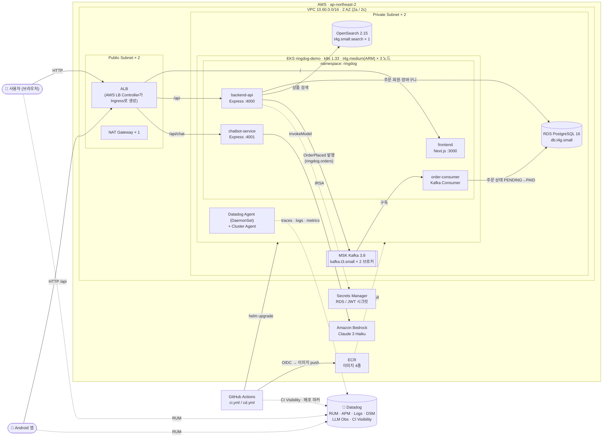

# RingDog

Datadog 풀스택 관측성(RUM, APM, Logs, CI/CD Visibility, DSM, LLM Observability, ASM, Infrastructure Monitoring)
데모용 키링 이커머스 애플리케이션. 전체 요구사항은 [`PRD_v1.yaml`](./PRD_v1.yaml) 참고.

## 아키텍처 구조도



### 요청 흐름 요약

| 경로 | 흐름 |
|---|---|
| 웹 페이지 | 사용자 → ALB `/` → `frontend` (Next.js SSR) |
| 상품/검색/장바구니/주문 API | ALB `/api` → `backend-api` → RDS(PostgreSQL) / OpenSearch |
| 주문 처리 (비동기) | `backend-api`가 MSK `ringdog.orders`에 `OrderPlaced` 발행 → `order-consumer`가 소비 → RDS에서 주문을 `PAID`로 변경 |
| 챗봇 | ALB `/api/chat` → `chatbot-service` → Amazon Bedrock (Claude 3 Haiku) |
| 관측성 | 각 Pod의 dd-trace → 노드별 Datadog Agent → Datadog / 브라우저·Android RUM SDK → Datadog |

## 인프라 구성 (`infra/terraform/envs/demo`)

데모용이라 **비용 최소화 사양**으로 구성되어 있습니다. 값은 모두 `variables.tf`의 기본값입니다.

| 구분 | 리소스 | 사양 / 설정 |
|---|---|---|
| 리전 / 네트워크 | VPC | `10.60.0.0/16`, **2 AZ** (`ap-northeast-2a`, `ap-northeast-2c`) |
| | 서브넷 | AZ별 Public 1 + Private 1 (총 4개) |
| | NAT Gateway | **1개** (단일 NAT, 비용 절감) |
| 컴퓨팅 | EKS 클러스터 | `ringdog-demo`, Kubernetes **1.33** |
| | 관리형 노드 그룹 | **t4g.medium × 3** (Graviton·ARM, AMI `AL2023_ARM_64_STANDARD`, min 1 / max 4), 온디맨드, 루트 디스크 20GB, Private Subnet 배치. 앱 이미지는 cd가 arm64로 빌드 |
| | 인그레스 | AWS Load Balancer Controller → internet-facing **ALB** (HTTP :80, target-type ip) |
| 데이터베이스 | RDS | **PostgreSQL 16**, `db.t4g.small`, 20GB, **Single-AZ** |
| 메시징 | Amazon MSK | **Kafka 3.8.x**, `kafka.t3.small` × **2 브로커** (AZ당 1, MSK에는 t4g가 없어 t3 유지), 브로커당 EBS 20GB, 클라이언트 통신은 평문(9092)과 TLS(9094) 둘 다 허용(앱은 평문 9092 사용), 브로커 간 통신은 암호화 |
| 검색 | Amazon OpenSearch | **OpenSearch 2.15**, `t4g.small.search` × **1 노드**, EBS 10GB, 노드 간 암호화 |
| 컨테이너 레지스트리 | ECR | `ringdog-frontend` / `ringdog-backend-api` / `ringdog-chatbot-service` / `ringdog-order-consumer` |
| 보안 / 권한 | IRSA | 서비스별 ServiceAccount IAM Role (`backend-api`, `chatbot-service`, `order-consumer`) |
| | Secrets Manager | RDS 접속 정보, JWT 서명 키 |
| | GitHub OIDC Role | GitHub Actions가 장기 Access Key 없이 ECR push / EKS 배포 |
| AI | Amazon Bedrock | `anthropic.claude-3-haiku-20240307-v1:0` (chatbot-service만 호출 가능) |
| State | S3 + DynamoDB | Terraform 원격 state / lock (`infra/terraform/bootstrap`, 상시 유지) |

### EKS 워크로드 (Helm `deploy/helm/charts/ringdog`, namespace `ringdog`)

| 서비스 | 역할 | 포트 | Replica | Ingress 경로 |
|---|---|---|---|---|
| `frontend` | Next.js 사용자 웹 + Datadog RUM | 3000 | 1 | `/` |
| `backend-api` | 인증/상품/검색/장바구니/주문 API, Kafka Producer | 4000 | 1 | `/api` |
| `chatbot-service` | Bedrock 기반 챗봇, LLM Observability | 4001 | 1 | `/api/chat` |
| `order-consumer` | `OrderPlaced` Kafka Consumer | (health 4002) | 1 | 없음 (내부 전용) |
| Datadog Agent | DaemonSet (노드당 1) + Cluster Agent / Admission Controller | — | 노드 수만큼 | — |

### Datadog 관측 구성

| 기능 | 수집 위치 |
|---|---|
| RUM | `frontend` (browser-rum + Next.js 플러그인), Android 앱 |
| APM + 로그 연계 | 백엔드 3개 서비스의 `dd-trace` + 공용 JSON logger (`dd.trace_id` 주입) |
| Logs | Agent가 전체 Pod의 JSON 로그 수집 |
| DSM | `backend-api`(Producer) → MSK → `order-consumer`(Consumer) 토폴로지/lag |
| LLM Observability | `chatbot-service`의 Bedrock 호출 |
| Infrastructure | Kube State Metrics, Process Agent, Kafka cluster check |
| CI/CD Visibility | GitHub Actions 파이프라인 + 배포 마커 |
| ASM | Remote Configuration 활성화 (앱 측 배선은 진행 중) |

> 💰 **비용 참고:** EKS·MSK·OpenSearch·RDS·NAT가 시간 단위로 과금되므로, 데모가 끝나면
> `kubectl delete ingress ringdog -n ringdog`로 ALB를 먼저 정리한 뒤 `terraform destroy`로 내립니다.
> (bootstrap S3/DynamoDB는 유지)

## 모노레포 구조

```
apps/
  frontend/           Next.js (App Router) 사용자 웹
  backend-api/        Express - 인증/상품/검색/장바구니/주문 API
  chatbot-service/    Express - Amazon Bedrock 기반 챗봇
  order-consumer/     Node - MSK(Kafka) OrderPlaced 컨슈머
  android-app/        Kotlin/Jetpack Compose 모바일 앱 (Datadog Android RUM)
packages/
  shared/             서비스 간 공유 TS 타입 및 이벤트 스키마
  db/                 Prisma 스키마 및 생성된 DB 클라이언트 (단일 소스)
infra/terraform/
  bootstrap/          Terraform 원격 state용 S3 + DynamoDB (최초 1회 수동 적용)
  modules/            vpc / eks / rds / msk / opensearch / ecr / iam-irsa / secrets
  envs/demo/          위 모듈을 조합하는 데모 환경 루트 스택
deploy/helm/          Datadog Agent Helm values, 서비스별 배포 매니페스트
.github/workflows/    GitHub Actions CI/CD (lint/test/terraform plan, build/push/deploy)
docs/                 아키텍처 및 데모 시나리오 문서
```

## 로컬 개발 준비

```bash
corepack enable
pnpm install
cp .env.example .env   # 각 서비스 .env 도 필요 시 개별 작성

docker compose up -d          # postgres / kafka / opensearch 로컬 기동
pnpm --filter @ringdog/db run generate
pnpm --filter @ringdog/db run migrate
pnpm --filter @ringdog/db run build     # dist 빌드 (다른 서비스가 컴파일된 클라이언트를 require 함)
pnpm --filter @ringdog/db run seed      # 샘플 키링 상품 60개 시드 (선택)

pnpm dev                      # 전체 앱 동시 기동 (frontend:3000, backend-api:4000, chatbot-service:4001)
```

## 배포 (AWS) → 데모

인프라 구축부터 서비스 배포, 데모 시연까지의 전체 절차는 [`docs/README.md`](./docs/README.md)에서 순서대로 따라가면 됩니다.

1. [사전 준비](./docs/setup/01-prerequisites.md) — 계정·권한·로컬 도구
2. [인프라 구축](./docs/setup/02-infra.md) — Terraform `bootstrap` / `envs/demo`
3. [서비스 배포](./docs/setup/03-deploy.md) — GitHub Actions `cd.yml` (Datadog Agent 포함)
4. [Datadog 설정](./docs/setup/04-datadog.md) — 키, RUM 애플리케이션, Slack
5. [데모 시나리오](./docs/demo/README.md)

세부 아키텍처는 [`docs/architecture.md`](./docs/architecture.md) 참고.

## 개발 단계 (PRD `delivery_plan` 기준)

- **M1**: AWS 인프라/IaC + CI/CD + Helm 차트 기반 구성 (완료)
- **M2**: 코어 이커머스 기능(인증/상품/검색/장바구니/주문/주문취소/상품상세) + 프론트 UI (완료)
- **M3**: 챗봇 Bedrock 실연동 및 LLM Observability (기능 완료, 응답 품질 점검 필요)
- **M4**: 관측성/보안/CI-CD 시연 고도화 (부분 완료 — ASM 앱 배선 및 대시보드 육안 확인 남음)

상세 현황은 [`docs/architecture.md`](./docs/architecture.md#4-현재-구현-상태-2026-07-10-기준) 참고.
