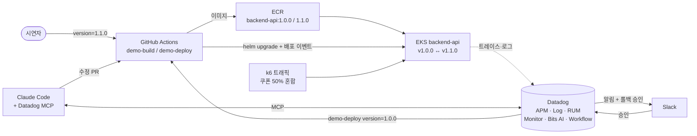

# 데모 시나리오 ② 배포 후 결제 에러 급증

> 탐지(Monitor·Watchdog) → AI 분석(Bits AI SRE·Chat) → 승인 기반 롤백(Workflow Automation) → 근본 수정(MCP)
>
> 설계: [`docs/design/specs/2026-10-13-demo-bad-deploy-design.md`](../../design/specs/2026-10-13-demo-bad-deploy-design.md)
> 구축 순서: 시나리오 ① [타임세일 트래픽 폭주 → DB 병목](../01-flash-sale-db/README.md)을 먼저 구축하고, **그 환경을 그대로 사용**해서 두 번째로 구축합니다.

## 1. 한 줄 요약

backend-api **v1.1.0**("쿠폰 코드 대소문자 무시" 기능 추가)을 배포하자 **쿠폰 없이 주문한 고객만 결제 실패(500)**. Datadog이 배포와 에러를 연결해 탐지·분석하고, Slack 승인 한 번으로 롤백, 개발자는 IDE에서 원인 수정 PR까지 완료합니다.

| 사용 제품 | APM(Deployment Tracking, Error Tracking) · Log · RUM · Monitor · Watchdog · Workflow Automation · **Bits AI SRE · Bits AI Chat · Datadog MCP** |
|---|---|

## 2. 시나리오 줄거리

> 개발팀이 "쿠폰 코드를 대소문자 구분 없이 받게 해 달라"는 요청을 반영해 v1.1.0을 배포했다.
> 배포 직후부터 일부 고객의 결제가 실패한다. 쿠폰을 입력한 고객은 문제가 없어서, 처음에는 "일부 고객만 겪는 간헐적 오류"처럼 보인다.

| 원인 | 실제 동작 | Datadog에서 보이는 것 |
|---|---|---|
| null 체크 누락 | `couponCode.trim().toUpperCase()` — 쿠폰을 입력하지 않으면 `couponCode`가 `undefined`라 `TypeError` | checkout 에러율 급증, Error Tracking 신규 이슈(`reading 'trim'`), 에러 로그 `error.stack` |
| 부분 장애 패턴 | 쿠폰 있는 주문은 성공, 없는 주문만 500 | 트레이스·RUM을 쿠폰 유무로 나누면 실패가 한쪽에만 몰림 |
| 배포와 동시 발생 | 버전이 `1.0.0` → `1.1.0`으로 바뀐 시점부터 에러 시작 | Deployment Tracking 버전 비교, 배포 이벤트 오버레이, (기준선이 있으면) Watchdog Faulty Deployment |

## 3. 시연 진행 (약 18분)

| 시간 | 단계 | 시연자 행동 | 사용 제품 | 화면 / 멘트 포인트 |
|---|---|---|---|---|
| 0:00 | 평시 | 데모 대시보드 소개 | APM, RUM | v1.0.0 정상. "지금은 정상 운영 중입니다" |
| 1:00 | 배포 | GitHub Actions `demo-deploy` → `version=1.1.0` | APM | APM 서비스 페이지에 새 버전 표시. "쿠폰 기능 개선 버전을 배포합니다" |
| 3:00 | 장애 발생 | 쇼핑몰에서 쿠폰 입력란을 **비우고** 주문 | RUM | 결제 실패 화면. "일부 고객이 결제에 실패합니다" |
| 4:00 | 탐지 | Slack 알림 확인 | Monitor, Watchdog | checkout 에러율 > 5% 알림. Watchdog Faulty Deployment는 표시된 경우에만 보조로 |
| 5:00 | AI 1차 조사 | 모니터의 **Bits AI SRE** 조사 결과 열기 | Bits AI SRE | 배포-에러-쿠폰 유무 패턴을 근거와 함께 정리. 결론은 매번 다를 수 있음 |
| 7:00 | 배포 영향 확인 | APM → Deployment Tracking에서 `1.0.0` vs `1.1.0` 비교 | APM | 새 버전에서만 생긴 에러 유형, 에러율 차이 |
| 8:00 | 원인 코드 확인 | Error Tracking 이슈 → 스택트레이스 → 같은 trace_id 로그 | APM, Log | `orders.ts`의 `trim` 호출 라인, 로그의 `error.kind`/`error.stack` |
| 9:00 | Bits Chat 질의 | Error Tracking 화면에서 Bits Chat 질문 | Bits AI Chat | 아래 프롬프트. 화면 탐색과 같은 결론인지 비교 |
| 10:00 | 즉시 대처 | Slack에서 **[롤백 승인]** 클릭 | Workflow Automation | GitHub `demo-deploy version=1.0.0` 실행 → 3분 후 에러율 회복 보고. "사람은 승인만, 롤백과 회복 확인은 자동" |
| 14:00 | 근본 수정 | Claude Code에 프롬프트 입력 | Datadog MCP | Error Tracking·트레이스 조회 → null-safe 수정 + 테스트 → PR. "IDE를 떠나지 않고 원인 수정까지" |
| 17:00 | 영향 확인 | RUM Session Replay, Funnel | RUM | 고객이 실제로 겪은 화면, 장애 구간의 결제 전환율 하락 |

### Bits AI SRE 예시 결론 (실제 결과는 매번 다를 수 있음)
> v1.1.0 배포 직후 `POST /api/orders/checkout`에서 `TypeError: Cannot read properties of undefined (reading 'trim')` 급증. 쿠폰 코드가 없는 요청에서만 발생. v1.0.0으로 롤백 권장.

### Bits AI Chat 프롬프트
```
v1.1.0 배포 이후 ringdog-backend-api checkout에서 새로 생긴 에러와 영향받은 요청 비율 알려줘.
이 에러가 쿠폰 코드 유무와 관련이 있어?
```

### MCP 시연 프롬프트
```
Datadog에서 ringdog-backend-api checkout 에러 원인을 찾아서 고쳐줘.
demo/fix-coupon-<날짜> 브랜치에서 테스트도 추가하고, demo/bad-deploy 대상으로 PR 만들어줘.
```

## 4. 대처 방법

| 구분 | 조치 | 비고 |
|---|---|---|
| 즉시 (완화) | v1.0.0 롤백 | Workflow로 Slack 승인 1회 |
| 근본 | `couponCode`가 없을 때 정규화를 건너뛰도록 수정 + 쿠폰 미입력 단위 테스트 추가 | MCP로 PR 생성. **머지하지 않음** (반복 시연용) |
| 재발 방지 | 쿠폰 미입력 케이스 테스트를 CI 필수로, 배포 후 에러율 기반 자동 롤백 기준 마련 | 3단계 CI/CD Optimization(Quality Gates)과 연결 |
| 하지 말아야 할 것 | 에러 로그만 보고 쿠폰 서비스(외부 연동)부터 의심하는 것 | 쿠폰 **있는** 주문은 성공한다는 사실로 반박 |

### 즉시 대처 Workflow 트리거

| 항목 | 내용 |
|---|---|
| 트리거 | APM 모니터 **"checkout 에러율 > 5% (5분)"** 의 알림 메시지에 `@workflow-<롤백 워크플로>` 핸들 |
| Composite를 쓰지 않는 이유 | 이 시나리오는 원인(배포)과 조치(롤백)가 1:1로 대응해서 에러율 단일 모니터로 충분 |
| Workflow 흐름 | 모니터 트리거 → Slack 메시지(요약 + [롤백 승인] [거부]) → 승인 시 GitHub `demo-deploy version=1.0.0` → 3분 대기 → 에러율 조회 → Slack 결과 보고. 거부/10분 무응답 시 "수동 대응 필요" |
| 안전장치 | `demo-deploy`는 버전 허용 목록(`1.0.0`, `1.1.0`)만 받음. (추가 제안) Workflow 첫 단계에서 최근 30분 내 배포 이벤트가 있는지 확인하고, 없으면 롤백 버튼 대신 "배포 무관 장애" 안내 |

## 5. 환경 구조

시나리오 ①에서 만든 환경과 공통 기반을 그대로 사용하고, 아래 항목만 추가합니다.

| 구분 | 재사용 (시나리오 ①에서 구축) | 시나리오 ② 추가 |
|---|---|---|
| 인프라 | EKS · RDS · MSK · OpenSearch, 팀 권한 스택, `cd.yml` 수동 실행 | — |
| Datadog 수집 | Agent, Unified Service Tagging(`DD_VERSION`), 에러 로그 `error.*` 필드 | — |
| 트래픽 | k6 API + k6 browser 생성기 | **쿠폰 50% 혼합 여정** 프로필 |
| 코드 | — | 버그 브랜치 `demo/bad-deploy` (main은 항상 정상) |
| 배포 | — | `demo-build.yml`(버전 이미지 빌드), `demo-deploy.yml`(배포/롤백, backend-api 태그만 교체) |
| Datadog 설정 | Slack 연동, GitHub Connection | checkout 에러율 모니터(+ Bits AI SRE 자동 조사), Watchdog 모니터, 롤백 Workflow, 데모 대시보드 |



## 6. 진행 현황

공통 기반 항목(CD 수동 실행, 팀 권한 스택, Unified Service Tagging, 트래픽 생성기, Slack·GitHub 연결)은 [시나리오 ① 진행 현황](../01-flash-sale-db/README.md#2-진행-현황)에서 관리합니다.

| # | 항목 | 상태 | 비고 |
|---|---|---|---|
| 0 | 설계 문서 작성 | ✅ 완료 | 2026-10-13 |
| 1 | 구현 계획 작성 | ✅ 완료 | [plan](../../design/plans/2026-10-13-demo-bad-deploy.md) — 구축 순서 변경으로 ① 완료 후 ② 전용 Task만 남기도록 재정리 예정 |
| 2 | docs 정리 + setup 가이드(01~04) | ✅ 완료 | 2026-10-13 |
| C2 | 버그 브랜치 `demo/bad-deploy` | ⬜ 대기 | |
| C3 | `demo-build.yml` (버전 이미지 빌드) | ⬜ 대기 | |
| C4 | `demo-deploy.yml` (배포/롤백) | ⬜ 대기 | |
| C5' | 트래픽 생성기 쿠폰 혼합 프로필 | ⬜ 대기 | 생성기 본체는 ① |
| C6-1 | 모니터: checkout 에러율 + Bits AI SRE | ⬜ 대기 | |
| C6-2 | 모니터: Watchdog | ⬜ 대기 | |
| C6-4 | Workflow: 승인 기반 롤백 | ⬜ 대기 | ①의 GitHub Connection 재사용 |
| C6-5 | 데모 대시보드 | ⬜ 대기 | |
| C7 | MCP 근본 수정 시연 리허설 | ⬜ 대기 | |
| R | 전체 리허설 (타이밍 측정) | ⬜ 대기 | |

상태 표기: ⬜ 대기 / 🔄 진행 중 / ✅ 완료 / ⚠️ 이슈

## 7. 데모 전 체크리스트

### 환경 준비 (데모 전, 환경이 없을 때)
- [ ] [setup 가이드](../../README.md#시작하기-순서대로) 1~4단계 완료: 인프라 생성 → 서비스 배포 → Datadog 수집 확인 (환경은 상시 유지하지 않음)
- [ ] `demo-build` 실행: `main → 1.0.0`, `demo/bad-deploy → 1.1.0` (ECR은 destroy 시 삭제되므로 환경 재생성마다 필요)

### 당일 (30분 전)
- [ ] Slack 데모 채널에 "데모 환경 사용 중" 공지 (환경 1개 공용)
- [ ] 시나리오 ①이 `reset` 상태인지 확인 (위젯 OFF, 락 Job 없음, k6 평시)
- [ ] 트래픽 생성기를 쿠폰 혼합 프로필로 실행 → APM 요청량, RUM 세션 수신 확인
- [ ] `demo-deploy version=1.0.0` 실행 (main push로 sha 태그가 되어 있을 수 있음)
- [ ] 모니터 상태 OK, 열린 인시던트/알람 없음
- [ ] Slack 채널, Datadog 탭(대시보드·APM·Error Tracking·Bits AI·RUM), GitHub Actions, Claude Code 미리 열기
- [ ] 이전 데모의 fix PR / 브랜치 정리

## 8. 리셋 절차
1. `demo-deploy version=1.0.0` 실행 (롤백이 안 된 경우)
2. 모니터 Resolve 확인
3. 시연 중 생성된 PR 닫기 + `demo/fix-coupon-*` 브랜치 삭제
4. 진행 중 Workflow 실행 취소 확인
5. 트래픽 생성기를 평시 프로필로 되돌리기
6. 환경을 더 쓰지 않으면 [환경 삭제](../../setup/02-infra.md#2-6-환경-삭제-데모-종료-후-필수)
7. Slack 데모 채널에 "데모 환경 사용 종료" 공지

> fix PR은 **절대 머지하지 않습니다.** `demo/bad-deploy`가 항상 버그 상태로 남아 있어야 다음 사람이 같은 데모를 할 수 있습니다.

## 9. 팀원 준비 (최초 1회)

권한(GitHub Write, AWS IAM, Datadog org, Slack 채널)과 도구 설치는 [사전 준비](../../setup/01-prerequisites.md),
MCP 시연 설정은 [Datadog 설정 4-4](../../setup/04-datadog.md#4-4-claude-code--datadog-mcp-mcp-시연용)를 따릅니다.

## 10. 작업 로그
| 날짜 | 내용 |
|---|---|
| 2026-10-13 | 시나리오 설계, 설계 문서·본 문서 작성. docs 정리 및 setup 가이드(01~04) 작성 |
| 2026-10-13 | 구현 계획 작성 (Task 1~10) — [작업 기록](../../worklog/2026-10-13.md) |
| 2026-10-15 | 구축 순서 변경: 타임세일 시나리오를 ①로 먼저 구축, 이 시나리오는 ②로 변경(폴더 `01-bad-deploy` → `02-bad-deploy`). 공통 기반 항목을 ①로 이관. 문서 구성을 ①과 같은 형식(줄거리·진행·대처·환경)으로 정리하고 Bits AI Chat 단계와 Workflow 트리거 설명 추가 |
