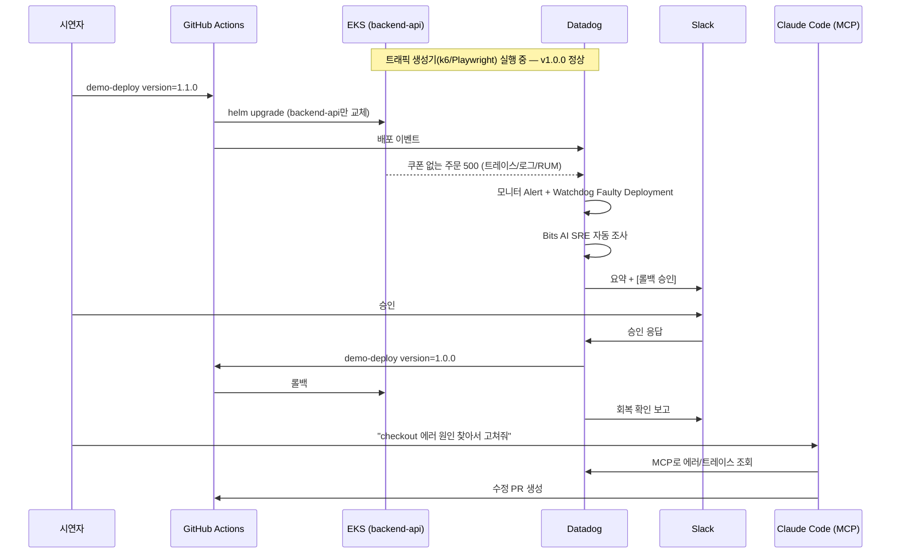

# 데모 메인 시나리오 ① "배포 후 결제 에러 급증" 설계

- 작성일: 2026-10-13
- 상태: 설계 검토 중
- 시나리오 운영 문서(대본·진행 현황): [`docs/demo/01-bad-deploy/README.md`](../../demo/01-bad-deploy/README.md)

## 1. 목적

고객 대상 Datadog 데모에서 **"실제로 가장 흔한 장애 = 배포 직후 에러 급증"** 을 재현하고, 다음 흐름을 한 번에 보여준다.

| 단계 | 사용 기능 | 보여줄 가치 |
|---|---|---|
| 탐지 | Monitor, **Watchdog** (Faulty Deployment Detection) | 임계치 없이도 "문제 있는 배포"를 자동 판별 |
| 분석 | **Bits AI SRE**, APM / Error Tracking / Logs / RUM | AI가 근거(트레이스·로그·배포 이벤트)와 함께 원인 결론 제시 |
| 대응 | **Workflow Automation** + Slack | 승인 버튼 한 번으로 롤백 → 회복 자동 검증 |
| 근본 수정 | **Datadog MCP Server** + Claude Code | IDE에서 자연어로 원인 조회 → 코드 수정 PR |
| 영향 확인 | RUM Session Replay / Funnel | 장애를 사용자 경험·전환율로 설명 |

최종 목표: 팀원이 repo 문서([`docs/README.md`](../../README.md))만 보고 **인프라·서비스 세팅 → 데모 시연**까지 직접 수행할 수 있을 것.

### 성공 기준
- 문제 버전 배포 후 **5분 이내** 모니터 알람 + Bits AI SRE 조사 시작
- Slack 승인 → 롤백 완료 → 회복 확인까지 **5분 이내**, 사람 개입은 승인 1회
- 데모를 **리셋 후 반복 실행** 가능 (main 브랜치 오염 없음)
- 환경이 없는 상태에서 문서 순서대로 따라 하면 데모 가능 상태까지 도달

## 2. 결정 사항

| 항목 | 결정 | 이유 |
|---|---|---|
| 문제 버전 배포 방식 | **사전 빌드 이미지 + `demo-deploy` workflow_dispatch** | 기존 `cd.yml`은 4개 서비스 전체 빌드로 10분+ 소요. backend-api 태그만 교체하면 1~2분. 실제 버전 교체라 Deployment Tracking / Watchdog이 진짜로 동작 |
| 버그 유형 | **쿠폰 코드 정규화 리팩터 버그** | `couponCode.trim()` null 체크 누락 → 쿠폰 없는 주문만 500. "쿠폰 유무"라는 패턴이 있는 부분 장애라 AI 원인 분석이 돋보임 |
| 버그 코드 위치 | `demo/bad-deploy` 브랜치에만 존재 | public repo main을 깨끗하게 유지, 반복 시연 |
| 버전 체계 | 정상 `1.0.0`(main 빌드), 문제 `1.1.0`(버그 브랜치 빌드) | 고객이 보기 쉬운 버전명 |
| Datadog 설정 관리 | `datadog/` 디렉터리에 JSON으로 보관 | 재현성. 모니터는 MCP로 생성, Workflow는 UI 작성 후 export |
| 사용 가능 환경 | Slack(repo 관리자 개인 Free 워크스페이스 채널, 팀원 초대), Bits AI SRE, Workflow Automation, Datadog 전체 권한 | 사용자 확인 완료 (2026-10-13) |

## 3. 구성 요소

### C0-1. `cd.yml` 수동 실행 추가 (main 반영)
- `on: workflow_dispatch` 추가 → 환경을 새로 만든 뒤 빈 커밋 push 없이 Actions 화면에서 배포 실행
- OIDC 신뢰 조건(`ref:refs/heads/main`)과 맞도록 main 브랜치에서 실행
- 반영 후 [`docs/setup/03-deploy.md`](../../setup/03-deploy.md) 3-2절 갱신

### C0-2. 팀 권한 스택 `infra/terraform/team/` (상시 유지)
팀원 입·퇴사를 IAM 그룹 멤버십만으로 관리한다 (사용자 결정, 2026-10-13). repo에 이름·ARN이 노출되지 않고, 환경 재생성 없이 즉시 반영된다.

| 리소스 | 내용 |
|---|---|
| IAM 그룹 `ringdog-demo-team` | 데모 팀원 IAM 사용자 소속. `AdministratorAccess`(terraform apply/destroy용) + `ringdog-demo-eks-admin` Role assume 허용 |
| IAM Role `ringdog-demo-eks-admin` | 신뢰: 같은 계정(root) — 실제 assume은 그룹 정책으로 허가된 사용자만. 권한 정책 없음(EKS 접근 전용) |

- 상태: 기존 S3 backend(`ringdog-tfstate-demo`)에 key `team/terraform.tfstate`. 비용 없음 → `envs/demo`와 달리 destroy하지 않음
- `envs/demo`: 이름으로 Role을 조회해 `aws_eks_access_entry` + `AmazonEKSClusterAdminPolicy`(cluster 범위) 연결 → 누가 apply하든 그룹 멤버 전원이 `kubectl` 사용 가능
- 팀원 kubeconfig: `aws eks update-kubeconfig ... --role-arn <ringdog-demo-eks-admin ARN>`
- 입사: IAM 사용자 생성 → 그룹 추가 → 액세스 키 발급(안전한 경로로 전달). 퇴사: 액세스 키 삭제 → 그룹 제거 → 사용자 삭제
- 반영 후 [`docs/setup/01-prerequisites.md`](../../setup/01-prerequisites.md), [`02-infra.md`](../../setup/02-infra.md) 갱신

### C1. Unified Service Tagging + 에러 정보 보강 (main 반영)
- `deploy/helm/charts/ringdog/templates/*.yaml` 4개 서비스 모두:
  - 환경변수 `DD_VERSION`, Deployment/Pod 라벨 `tags.datadoghq.com/env|service|version`
  - 버전 값: 서비스별 `<svc>.version` → 없으면 `image.tag`
- 서비스별 이미지 태그 오버라이드: `backendApi.image.tag` (없으면 전역 `image.tag`). `_helpers.tpl`의 `ringdog.image`에 반영
- `apps/backend-api/src/middleware/errorHandler.ts`: 로그에 `error.kind`, `error.message`, `error.stack` 필드 추가 → Log 기반 Error Tracking, Bits AI 근거 강화
- dd-trace express 연동이 `next(err)` 에러를 span에 기록하는지 확인(Error Tracking 스택트레이스). 부족하면 errorHandler에서 활성 span에 에러 태그 설정

### C2. 버그 브랜치 `demo/bad-deploy`
- main 기준 커밋 1개: "feat(orders): 쿠폰 코드 대소문자 무시 처리"
- `apps/backend-api/src/routes/orders.ts` checkout에서
  `const normalized = couponCode.trim().toUpperCase();` (null 체크 없음) → 쿠폰 미입력 시 `TypeError: Cannot read properties of undefined (reading 'trim')`
- 쿠폰을 입력한 주문(`ringdog100` 소문자 포함)은 정상 성공 → 부분 장애
- 참고: 프론트 장바구니의 쿠폰 입력란 기본값이 `RINGDOG100`이므로, 시연자가 입력란을 비우고 주문하면 에러 재현

### C3. `.github/workflows/demo-build.yml` (workflow_dispatch)
- 입력: `ref`(브랜치), `version`(예: `1.0.0`, `1.1.0`)
- backend-api 이미지를 빌드해 ECR `ringdog-backend-api:<version>`으로 push
- 데모 준비 시 1회씩 실행 (main→1.0.0, demo/bad-deploy→1.1.0). ECR은 terraform destroy 시 함께 삭제되므로 환경 재생성 후 재실행 필요

### C4. `.github/workflows/demo-deploy.yml` (workflow_dispatch)
- 입력: `version`
- `helm upgrade ringdog ... --reuse-values --set backendApi.image.tag=<v> --set backendApi.version=<v>` → `kubectl rollout status`
- Datadog 이벤트 API로 배포 마커 전송 (`service:ringdog-backend-api`, `version:<v>`)
- **롤백도 동일 워크플로** (`version=1.0.0`) — Workflow Automation이 GitHub 액션으로 호출

### C5. 트래픽 생성기 (클러스터 내부 실행)
- 위치: `tools/demo-traffic/` + Helm 템플릿(토글 `trafficGen.enabled`)
- **k6** (API 트래픽): 회원가입/로그인 → 상품 목록·검색 → 장바구니 담기 → 주문(50% 쿠폰 / 50% 미입력). 평시 약 1~2 RPS
- **Playwright** (브라우저 RUM): 같은 여정을 실제 Chromium으로 약 1세션/분 → RUM 세션, Session Replay, Funnel 데이터 생성. 버그 버전에서는 결제 실패 화면이 Replay에 남음
- 대상: 클러스터 내부 frontend/backend Service가 아닌 **ALB 주소**(RUM은 브라우저에서 Datadog으로 전송되어야 하므로 실제 경로 사용)
- 실행 시점: 데모 시작 약 30분 전부터 (환경 상시 유지하지 않음)
- 리소스: Playwright 약 500MB 메모리. 실제로 노드가 부족해지면 그때 증설 검토

### C6. Datadog 설정 (`datadog/`)
| 파일 | 내용 |
|---|---|
| `datadog/monitors/checkout-error-rate.json` | APM `ringdog-backend-api` `post_/api/orders/checkout` 에러율 > 5% (5분). 알림: Slack 채널 + `@workflow-<롤백 워크플로>`. **Bits AI SRE 자동 조사 활성화** |
| `datadog/monitors/watchdog-backend-api.json` | Watchdog 모니터 (backend-api 이상/Faulty Deployment) |
| `datadog/workflows/rollback-backend-api.json` | 트리거: 모니터 → ① Slack 요약 메시지 + [롤백 승인/거부] → ② 승인 시 GitHub `demo-deploy` 실행(`version=1.0.0`) → ③ 3분 대기 → ④ 에러율 메트릭 조회 → ⑤ Slack 결과 보고 |
| `datadog/dashboards/demo-bad-deploy.json` | 버전별 요청/에러율, checkout p95, RUM 에러, 배포 이벤트 오버레이 |

- 모니터는 Datadog MCP(`create_datadog_monitor`)로 생성 후 정의를 커밋
- Workflow는 UI에서 작성 후 JSON export → **커밋 전 Connection ID, Slack 채널 ID, AWS 계정 ID 마스킹** (public repo)
- GitHub Connection: 이 repo에만 `actions:write` 권한의 fine-grained 토큰 또는 GitHub App

### C7. MCP 근본 수정 시연
- Claude Code + Datadog MCP에서 고정 프롬프트 사용:
  "Datadog에서 ringdog-backend-api checkout 에러 원인을 찾아서 고쳐줘. 수정 브랜치에서 테스트도 추가해."
- 기대 동작: Error Tracking/트레이스 조회 → `orders.ts` 해당 라인 특정 → null-safe 수정 + 단위 테스트 → `demo/fix-coupon-<날짜>` → `demo/bad-deploy` 대상 PR 생성 (**머지하지 않음**, 시연 후 닫기)
- 머지하지 않으므로 `demo/bad-deploy`는 항상 버그 상태로 유지 → 팀원 누구나 같은 데모 반복 가능 (9장 참고)

## 4. 데이터 흐름

## 5. 오류 처리 및 안전장치
- `demo-deploy`는 `version` 입력을 허용 목록(`1.0.0`, `1.1.0`, `1.1.1`) 으로 제한
- Workflow 롤백은 반드시 Slack 승인 단계 경유. 거부/타임아웃(10분) 시 Slack에 "수동 대응 필요" 보고
- `cd.yml`(main push)은 backend-api를 sha 태그로 되돌리므로, 데모 직전 `demo-deploy version=1.0.0` 1회 실행을 체크리스트에 포함
- 트래픽 생성기는 데모 계정(`demo-traffic-*`)만 사용, 대상은 데모 ALB로 고정

## 6. 테스트 / 검증
| 대상 | 방법 |
|---|---|
| C1 | 배포 후 APM 서비스 페이지에 version 표시, Pod 라벨 확인 |
| C2 | 단위 테스트로 쿠폰 미입력 시 TypeError 재현 (버그 브랜치) |
| C3/C4 | 1.0.0 ↔ 1.1.0 교체 후 Deployment Tracking에 두 버전 비교 표시 |
| C5 | Datadog에서 RUM 세션·Replay 수신, APM 요청량 확인 |
| C6 | 모니터 테스트 알림 → Workflow 수동 실행 → Slack 승인 → 실제 롤백 확인 |
| C7 | 리허설 1회로 PR 생성까지 확인 |

## 7. 전제 및 리스크
- **환경은 상시 유지하지 않음** (사용자 결정, 2026-10-13). 따라서 Watchdog / Faulty Deployment Detection은 기준 데이터 부족으로 **표시되지 않을 수 있음** → 탐지의 주 경로는 **모니터 알람**, Watchdog은 "표시되면 보여주는 보조 화면"으로 배치. 상시 유지가 필요해지면 그때 재검토
- Bits AI SRE 결론은 비결정적 → 리허설로 결과 품질 확인, 대본에는 "예시 결론"만 기재
## 8. 범위 외
- DBM / Infra / Log 단독 시나리오 (별도 문서로 후속)
- 프론트엔드 RUM 버전 태깅, 소스맵 업로드
- ASM

## 9. 팀원 공동 사용
팀원이 repo에 초대되어 직접 인프라·서비스를 세팅하고 같은 데모를 시연할 수 있도록 다음을 전제로 한다. 상세 절차는 [`docs/setup/`](../../setup/01-prerequisites.md).

| 항목 | 방식 |
|---|---|
| GitHub | repo **Write** 권한으로 초대 (workflow_dispatch 실행에 필요). Actions Secrets는 repo 단위라 팀원도 그대로 사용. main 브랜치 보호 규칙 권장 |
| 데모 환경(AWS) | repo 관리자 AWS 계정 공용, 환경 1개. 팀원은 각자 IAM 사용자(공유 키 금지)로 직접 terraform apply/destroy. 권한은 IAM 그룹 `ringdog-demo-team`으로 관리, `kubectl`은 공용 Role로 접근 (C0-2) |
| CD 수동 실행 | 현재 `cd.yml`은 main push로만 실행 → 환경 재생성 후 배포를 위해 `workflow_dispatch` 추가 (구현 범위에 포함) |
| Datadog | 같은 org에 팀원 계정 초대. 모니터·Workflow·대시보드는 org 공용 리소스라 그대로 사용 |
| Slack | repo 관리자의 개인 Slack(Free) 데모 채널 사용, 팀원 초대 |
| MCP 시연 | 각자 PC에 Claude Code + Datadog MCP 설정 ([`docs/setup/04-datadog.md`](../../setup/04-datadog.md)) |
| 동시 사용 | 환경이 1개이므로 **동시에 한 명만 시연**. 시작·종료를 Slack 데모 채널에 공지 |
