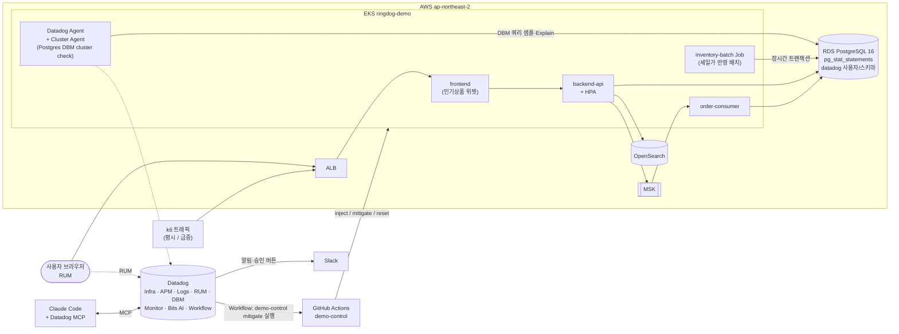
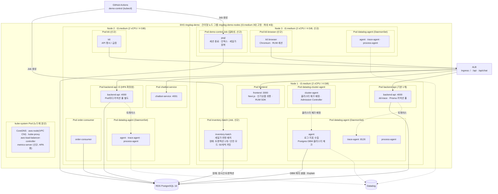

# 데모 시나리오 ① "타임세일 트래픽 폭주 → DB 병목" 설계 (초안)

- 작성일: 2026-10-15
- 상태: **설계 확정 (2026-10-16)**. 구현 계획: `docs/design/plans/2026-10-16-demo-flash-sale-db.md`
- 2026-10-16 보강: 원인 ② 배치의 실체와 7단계 발견 경로(4.6), 위젯 표시 규칙(4.7), "위젯 OFF는 롤백 아님", "인덱스는 원인 ①만 해결" 명시. 2차 대처에 배치 안전 모드 자동 재실행 추가, EKS 내부 구조도(4.1.1), metrics-server·노드 3대 고정·리소스 요청값, 8장 1~4번 확정
- 시나리오 운영 문서(대본·진행 현황): [`docs/demo/01-flash-sale-db/README.md`](../../demo/01-flash-sale-db/README.md)
- 구축 순서: **이 시나리오 ①을 먼저 구축**하면서 데모 공통 기반(4.3)을 함께 만든다. 시나리오 ② [배포 후 결제 에러 급증](./2026-10-13-demo-bad-deploy-design.md)은 그 환경을 그대로 사용해 두 번째로 구축한다.

## 1. 목적

부서 공용 Datadog 데모 환경(RingDog)에서 **Infra · APM · Log · RUM · DBM 5개 제품을 하나의 장애 흐름으로** 보여준다.
**"코드는 정상인데 데이터·트래픽·운영 작업이 겹쳐서 생기는 DB 장애"** 를 다룬다. (시나리오 ②는 "코드 결함(배포)" 장애)
분석 단계마다 **Bits AI(SRE 조사 / Chat)** 와 **Datadog MCP Server** 를 사용하는 장면을 넣어, 사람이 화면을 오가는 분석과 AI 보조 분석을 함께 보여준다.

시나리오 ①·②가 구축된 뒤 3단계로 **CI/CD Optimization, DSM, Jobs Monitoring** 시연을 같은 환경에 추가한다(7장).

### 보여줄 가치

| 메시지 | 근거 장면 |
|---|---|
| 사용자 체감에서 DB 원인까지 **한 화면씩 이어서** 내려간다 | RUM → APM 트레이스 → DB span → DBM 쿼리/Explain Plan |
| 원인이 두 개 겹쳐도 **분리해 낸다** | DBM의 "느린 쿼리(인덱스 누락)" vs "Blocking(락)" 을 각각 특정 |
| **잘못된 대응을 데이터로 막는다** | Pod 스케일 아웃이 DB 커넥션만 늘려 악화되는 장면 (Infra + DBM) |
| AI가 **근거와 함께** 원인을 요약하고, IDE에서 수정까지 이어진다 | Bits AI SRE 조사, Bits Chat 질의, MCP + Claude Code 인덱스 마이그레이션 PR |

### 성공 기준
- `demo-control inject` 실행 후 **5분 이내** Composite 모니터 알림
- 시연자가 RUM → APM → DBM → Infra → Log 순서로 원인 2개(인덱스 누락, 락 경합)를 **10분 이내** 특정
- 대처를 **2번에 나눠** 보여준다: 1차(위젯 OFF) 후 DB CPU는 회복되지만 결제는 여전히 실패 → 2차(블로킹 세션 종료 + 배치 안전 모드 재실행) 후 **3분 이내** checkout p95 정상화, 세일가 반영 완료
- `demo-control reset` 1회로 다음 시연자가 같은 상태에서 시작 가능

## 2. 시나리오 줄거리

> 오늘 20시 타임세일. 마케팅팀이 이벤트용 **"실시간 인기상품" 위젯**을 상품 목록에 켰다.
> 세일 시작 직후 운영팀의 **"타임세일 가격·재고 반영 배치"**(`inventory-batch`)가 돌기 시작했다. 세일 상품의 가격을 세일가로 바꾸고 세일 물량을 재고에 넣는 배치다.
> 세일 시작과 함께 트래픽이 평시의 5~10배로 늘었고, 고객센터에 "결제 버튼을 눌러도 계속 돌기만 한다"는 문의가 들어온다.
> (청중에게는 위젯과 트래픽만 먼저 알려 주고, 배치는 7단계에서 Datadog으로 찾아낸다.)

| 겹친 원인 | 실제 동작 | Datadog에서 보이는 것 |
|---|---|---|
| ① 인덱스 누락 집계 쿼리 | 위젯 API가 `order_items`를 `product_id`로 집계. 인덱스가 없어 대량 데이터 Seq Scan → 페이지마다 수백 ms~수 초 | DBM Top Query 1위, Explain Plan `Seq Scan`, RDS CPU 100% / CPU 크레딧 소진 |
| ② 락 경합 | 세일가 반영 배치가 상품 전체를 **트랜잭션 하나**로 묶어 하나씩 처리하고 마지막에만 커밋 → 이미 수정한 세일 상품 행의 락을 계속 쥠 → 바로 그 상품을 사려는 checkout의 재고 차감 `UPDATE`가 대기 (4.6) | DBM Blocking 트리(블로커 `application_name=inventory-batch`, `idle in transaction`), Wait Event `Lock:tuple/transactionid`, checkout 트레이스의 긴 postgres span, 배치 진행 로그 |
| (증폭) 트래픽 급증 + HPA | Pod가 늘수록 Prisma 커넥션 풀 총합이 늘어 DB 부하 가중 | Infra Pod 수 증가와 DBM 커넥션 수·대기 증가가 같은 시점 |

## 3. 시연 진행 (약 29분)

대처를 **1차(위젯 OFF) → 2차(블로킹 세션 종료)** 로 나눈다. 1차 후 DB CPU는 내려가는데 결제는 계속 실패하는 장면으로 "원인이 하나가 아니다"를 보여주고, 다시 분석해서 두 번째 원인을 찾는다.
이를 위해 `inject`는 **트래픽 급증 + 위젯 ON을 먼저**, **세일가 반영 배치는 3분 뒤** 시작한다 (원인 ①이 먼저 드러나도록).
1차 대처 "위젯 OFF"는 **롤백이 아니다**. 이미지·코드 버전은 그대로 두고 기능 플래그만 끈다(시나리오 ②의 롤백과 구분).

| 단계 | 시간 | 시연자 행동 | 사용 제품 | 화면 / 포인트 |
|---|---|---|---|---|
| 0. 평시 | 0:00 (3분) | 서비스 맵, RUM 대시보드, 데모 대시보드 소개 | Infra, APM, RUM | 정상 LCP·checkout p95·RDS CPU 기준선 |
| 1. 장애 주입 | 3:00 (1분) | GitHub Actions `demo-control` → `action=inject` | — | k6 급증 + 위젯 ON 즉시, 세일가 반영 배치(`inventory-batch` Job)는 3분 뒤 자동 시작 |
| 2. 탐지 + AI 1차 조사 | 4:00 (2분) | Slack 알림 확인 → 모니터의 **Bits AI SRE** 조사 결과 | Monitor (Composite), Bits AI SRE | **RUM 결제 지연 AND APM checkout p95 증가** 일 때만 알림. AI 결론은 비결정적이므로 "1차 방향"으로만 활용 |
| 3. 첫 번째 원인 | 6:00 (3분) | DBM Query Metrics → Top Query → Explain Plan. Bits Chat Q1 | DBM, Bits AI Chat | **원인 ① 인기상품 쿼리 Seq Scan**, RDS CPU 100%. Q1 "이 쿼리가 왜 느려졌고 어떻게 개선해?" |
| 4. 1차 대처 | 9:00 (2분) | Slack "인기상품 API 지연 지속" 알림의 **[위젯 OFF]** 승인 | Workflow Automation | 플래그 OFF → DB CPU 하락 확인. "이제 해결됐을까요?" |
| 5. 그런데 결제는 여전히 실패 | 11:00 (2분) | RUM에서 결제 버튼 frustration 세션 → Session Replay | RUM | 여전히 무한 로딩, Rage Click. RUM → 연결된 APM 트레이스로 이동 |
| 6. 서비스 지연 | 13:00 (3분) | checkout 트레이스 Flame Graph | APM, Log | postgres span이 CPU가 아니라 **대기**로 8초+. 같은 trace_id 로그 `P2024 connection pool timeout` |
| 7. 두 번째 원인 | 16:00 (4분) | DBM Blocking 트리 → 블로커 세션 상세 → Kubernetes Explorer의 `inventory-batch` Job → 배치 로그 → checkout p95 그래프의 이벤트 오버레이. Bits Chat Q2 | DBM, Infra(Kubernetes), Log, Bits AI Chat | **원인 ② 세일가 반영 배치가 checkout을 막음**. 블로커가 `idle in transaction`으로 N분째 열려 있음 → 배치가 장애 주입 3분 뒤 시작 → 로그 "312/1,200 처리 중"(아직 안 끝남) → 배치 시작 시점 = 결제 지연 시작 시점. Q2 "지금 checkout을 막고 있는 DB 세션이 뭐야?" (4.6) |
| 8. 인프라 확인 | 20:00 (2분) | Infra 대시보드에서 3:00~9:00 구간 그래프 | Infra | 4.5 "스케일 아웃 함정" 장면. Pod 수·DB 커넥션 증가, RDS CPU 100%·크레딧 소진, checkout 응답 시간은 그대로 |
| 9. 2차 대처 | 22:00 (3분) | Slack "DB 블로킹 세션 지속" 알림의 **[블로킹 세션 종료]** 승인 (승인 메시지에 "진행 중이던 세일가 반영은 롤백되고, 안전 모드로 자동 재실행합니다" 안내) | Workflow Automation, Log | 세션 종료 → 같은 Workflow가 배치를 **안전 모드**(50개씩 커밋, `lock_timeout` 2초)로 자동 재실행 → 배치 로그 "1,200/1,200 완료" → 3분 후 checkout p95 회복·블로킹 0·세일가 반영 완료 자동 보고. 멘트: "재발 방지 방식으로 다시 돌린 배치는 결제를 막지 않습니다" |
| 10. 원인 ① 근본 수정 | 25:00 (3분) | Claude Code + Datadog MCP | MCP Server | "DBM에서 가장 느린 쿼리와 Explain Plan 가져와서 인덱스 마이그레이션 만들어줘" → Prisma 마이그레이션 + PR(머지 안 함). **인덱스는 원인 ①만 해결**한다는 점을 짚는다 |
| 11. 정리 | 28:00 (1분) | (선택) MCP로 장애 타임라인 요약 → 포스트모템 초안 | MCP / Bits AI | 탐지~회복 시각, 원인 2개, 재발 방지(원인 ①: 인덱스·캐시 / 원인 ②: 배치 시간대 분리·작은 단위 커밋·`lock_timeout`) |
| 리셋 | — | `demo-control` → `action=reset` | — | 인덱스 원복(삭제), 플래그 OFF, 배치 Job 정리, **세일가를 정상가로 원복**(안전 모드 재실행이 커밋한 값), k6 평시 |

### 대처 방법 정리 (대본 부록으로 사용)

| 구분 | 조치 | 비고 |
|---|---|---|
| 1차 (완화) | 위젯 OFF (원인 ①) | Slack 승인 1회. 롤백이 아니라 기능 플래그 OFF(코드 버전 그대로). DB CPU는 회복되지만 결제는 여전히 실패 → 추가 분석으로 이어짐 |
| 2차 (완화) | 블로킹 세션 종료 + 배치 안전 모드 자동 재실행 (원인 ②) | Slack 승인 1회. 세션을 끊으면 배치 트랜잭션이 롤백되어 세일가 반영이 0개가 됨(커밋 전 변경은 원래 고객에게 보이지 않았으므로 상황이 나빠지지는 않음) → 같은 Workflow가 50개씩 커밋하는 안전 모드로 다시 실행해 세일가 반영까지 끝냄. 트래픽(k6 급증)은 그대로 유지 |
| 원인 ① 근본 해결 | `order_items(product_id)` 인덱스 생성, 위젯 결과 캐시(예: 60초) | MCP로 PR 생성 |
| 원인 ② 근본 해결 | 세일가 반영 배치를 세일 시간대 밖으로, 작은 단위로 자주 커밋, 배치·checkout에 `lock_timeout` 설정 | 포스트모템 항목 (코드 PR이 아니라 운영 방식 변경) |
| 하지 말아야 할 것 | Pod 스케일 아웃만 하는 것 | 8단계 장면으로 근거 제시 |

> **인덱스 마이그레이션은 원인 ①만 해결한다.** 원인 ②는 느린 쿼리가 아니라 같은 행의 락을 기다리는 문제라서, 인덱스가 있어도 배치가 커밋할 때까지 checkout은 기다린다.

## 4. 환경 구조

### 4.1 구조도

### 4.1.1 EKS 내부 구조 (Node · Pod · Container)

- Pod 배치는 예시다. 실제 노드는 스케줄러가 정하고, `datadog-agent`(DaemonSet)만 노드마다 1개씩 뜬다. MSK·OpenSearch 연결은 4.1 참고
- 앱 Pod는 컨테이너 1개(사이드카 없음). dd-trace는 앱 컨테이너 안의 라이브러리이고, Cluster Agent의 Admission Controller가 `DD_AGENT_HOST` 등을 주입해 **같은 노드의 trace-agent**로 트레이스를 보낸다
- DBM은 Cluster Agent가 Postgres 체크를 노드 Agent 하나에 배정해, 그 Agent가 RDS 엔드포인트에 직접 연결해 수집한다
- **현재 환경에 없어서 추가하는 것**:
  - **metrics-server**: 없으면 CPU 기준 HPA가 동작하지 않아 8단계 "스케일 아웃 함정" 장면이 나오지 않는다 → `cd.yml`에서 Helm으로 `kube-system`에 설치(aws-load-balancer-controller 설치 단계 옆). HPA는 `cpu` 사용률 기준이므로 backend-api에 CPU `requests`가 반드시 있어야 한다
  - **노드 용량**: Cluster Autoscaler·Karpenter가 없어 노드 수는 자동으로 늘지 않는다. 노드 자동 확장은 시연 대상이 아니므로 설치하지 않고, **노드를 3대로 고정**한다(`node_desired_size` 2 → 3, `node_max_size` 3 → 4, `node_min_size`는 1 유지). 비용은 t3.medium 1대분(시간당 약 $0.05) 증가하며, 환경은 시연 때만 띄우므로 영향이 작다
  - **리소스 요청값**: 모든 Pod(앱 4개, k6, k6-browser, inventory-batch, demo-control Job)에 `requests`/`limits`를 지정해, HPA 최대(backend-api 4개) + k6 browser(Chromium, 메모리 약 1 GiB) + Agent가 3대에 Pending 없이 올라가도록 한다. 실제 값은 리허설에서 `kubectl top`으로 확인 후 조정

### 4.2 시나리오 ① 전용 추가·변경 항목

| 구분 | 내용 | 비고 |
|---|---|---|
| RDS 파라미터 그룹 | `shared_preload_libraries=pg_stat_statements`, `track_activity_query_size=4096`, (선택) `track_io_timing=on` | Terraform `modules/rds`에 파라미터 그룹 추가. 적용 시 재시작 필요 |
| RDS 사양 | `db.t3.micro`(1GB) → **`db.t3.small`** (결정) | 대량 데이터 + DBM 수집 안정성. 비용 소폭 증가 |
| EKS 노드 | `node_desired_size` 2 → **3**, `node_max_size` 3 → 4, metrics-server 설치, 모든 Pod에 `requests`/`limits` | 4.1.1. HPA 동작과 Pending 방지 |
| DBM 준비 SQL | `datadog` 사용자, `datadog` 스키마, `pg_monitor` 권한, `pg_stat_statements` 확장, `datadog.explain_statement` 함수 | CD의 migrate 단계 뒤에 실행. 비밀번호는 Secrets Manager |
| Datadog Agent | Cluster Agent cluster check로 Postgres 체크 `dbm: true`, RDS 엔드포인트 직접 연결. 블로킹 지표용 `custom_queries` 추가(4.4) | `deploy/helm/datadog-agent/values.yaml` (`clusterChecks` 활성화) |
| AWS 연동 | Datadog AWS Integration (CloudWatch: RDS·ALB·MSK, Resource Collection) | IAM Role은 비용이 없으므로 상시 유지 `infra/terraform/team/`에 배치 |
| 앱 (backend-api) | `GET /api/products/trending` (인덱스 없는 집계, 플래그 OFF면 집계 없이 `{ enabled: false }` 반환), checkout 재고 차감 `UPDATE products` 트랜잭션 | main에 반영. 위젯 플래그 OFF가 기본 |
| 앱 (frontend) | 상품 목록 상단 "실시간 인기상품" 위젯. 표시 규칙은 4.7 | RUM에 위젯 로딩 시간 표시 |
| 플래그 | **ConfigMap 환경변수 `FEATURE_TRENDING_WIDGET`** (결정. Datadog Feature Flags는 이후 확장). **플래그는 backend-api가 소유** — Next.js `NEXT_PUBLIC_*` 값은 빌드 시 고정되어 ConfigMap 변경이 반영되지 않기 때문 | ConfigMap 방식은 반영에 `rollout restart`가 필요해 화면상 재배포처럼 보임 → 시연 멘트로 "같은 버전, 기능 스위치만 끕니다"를 짚음 |
| 데이터 | 대량 주문 시드 Job: 주문 약 50만 건, `order_items` 약 150만 건 | 환경 재생성마다 1회 실행 (약 10분 예상, 리허설로 확인) |
| k8s | backend-api HPA(CPU 기준, 1→4) + metrics-server, 세일가 반영 배치 Job `inventory-batch`(`inject` 3분 뒤 시작, 최대 30분, 동작은 4.6) | 2차 대처 시점(약 19분 뒤)까지 락이 유지되어야 함. 노드 용량은 4.1.1 |
| 데모 제어 | `.github/workflows/demo-control.yml` (workflow_dispatch: `spike` / `inject` / `mitigate` / `reset`) | 인덱스 삭제·생성, 플래그 토글, 배치 Job 실행(장애 모드 / 안전 모드)·삭제, 블로킹 세션 종료, 세일가 원복 |
| Datadog 설정 | `datadog/` 에 JSON 보관: Composite 모니터(사람 알림), 인기상품 API 지연 지속 모니터, DB 블로킹 세션 지속 모니터, 완화 Workflow 2개(위젯 OFF / 세션 종료), 데모 대시보드 | 커밋 전 ID 마스킹(public repo) |

### 4.3 데모 공통 기반 (①에서 구축, ②·3단계에서 재사용)

시나리오 ② 설계(2026-10-13)에 있던 공통 구성 요소를, 구축 순서 변경에 따라 시나리오 ① 구축 범위로 옮긴다.

| 구성 요소 | 내용 | 원래 위치 |
|---|---|---|
| CD 수동 실행 | `cd.yml`에 `workflow_dispatch` 추가 (환경 재생성 후 빈 커밋 없이 배포) | ② 설계 C0-1 |
| 팀 권한 스택 | `infra/terraform/team/` — IAM 그룹 `ringdog-demo-team` + EKS 관리자 Role (상시 유지). AWS 연동용 Datadog IAM Role도 여기에 둠 | ② 설계 C0-2 |
| Unified Service Tagging | 4개 서비스 `DD_VERSION` + `tags.datadoghq.com/*` 라벨, 서비스별 이미지 태그 오버라이드, 에러 로그 `error.*` 필드 | ② 설계 C1 |
| 트래픽 생성기 | k6(API) + k6 browser(RUM). ①은 **평시 / 급증** 프로필, ②는 **쿠폰 50% 혼합** 여정을 같은 생성기에서 사용 | ② 설계 C5 |
| Slack 연동 + GitHub Connection | Datadog Slack 앱(데모 채널), Workflow용 GitHub Connection(이 repo `actions:write`) | ② 설계 C6 일부 |

### 4.4 대처 Workflow 트리거 (1차 / 2차)

Composite 모니터는 사람에게 알리는 용도로만 쓰고 조치를 트리거하지 않는다. 증상(결제 지연)만으로는 원인이 무엇인지 알 수 없기 때문이다. 조치는 **원인별 모니터**가 각각 트리거한다.

| 항목 | 1차: 위젯 OFF (원인 ①) | 2차: 블로킹 세션 종료 (원인 ②) |
|---|---|---|
| 트리거 모니터 | **"인기상품 API 지연 지속"** — APM `GET /api/products/trending` p95 > 2초가 3분 지속 (대안: DBM 쿼리 지연 지표) | **"DB 블로킹 세션 지속"** — 30초 이상 다른 세션을 막는 세션 ≥ 1 이 **5분** 지속 |
| 알림 연결 | 알림 메시지에 `@workflow-<위젯 OFF 워크플로>` | 알림 메시지에 `@workflow-<세션 종료 워크플로>` |
| 지표 | APM 트레이스 지표 (서비스·리소스 기준이라 결정적) | Postgres 체크 `custom_queries`로 `pg_blocking_pids()` 기반 지표(예: `ringdog.db.blocked_sessions`) 직접 생성. 대안: 체크 기본 지표(`postgresql.locks` 등) — 정확한 지표명은 환경 기동 후 확인 |
| Slack 버튼 | [위젯 OFF] [무시] | [블로킹 세션 종료] [무시]. 승인 메시지에 영향 안내: "진행 중이던 세일가 반영은 롤백되고, 안전 모드로 자동 재실행합니다" |
| 조치 | `demo-control mitigate target=widget` → 플래그 OFF | `demo-control mitigate target=session` → psql Job으로 세션 종료 → **이어서 자동으로** 배치를 안전 모드(`BATCH_MODE=safe`)로 재실행. 승인은 1회 |
| 결과 보고 | 3분 후 RDS CPU·trending p95 조회 → Slack 보고 | 3분 후 checkout p95·블로킹 지표·배치 완료 여부(세일가 반영 1,200/1,200) 조회 → Slack 보고 |

- **알림 순서**: 락은 `inject` 3분 뒤 시작하고 블로킹 모니터는 5분 지속 조건이라, 2차 알림은 1차 대처 무렵(장애 주입 후 약 8분)에 도착한다. 대본상 2차 알림은 "두 번째 원인을 DBM으로 확인한 뒤" 처리한다. 도착 시점은 리허설로 조정
- **조치 실행 방식**: **A로 결정.** Workflow가 GitHub Actions `demo-control` `action=mitigate` 실행 → 러너가 `kubectl`로 클러스터 내부에서 조치. 시나리오 ②의 롤백과 같은 GitHub Connection 사용, 추가 구성 요소 없음. (검토했던 대안 B: EKS에 Datadog Private Action Runner 설치 → Workflow의 PostgreSQL/Kubernetes 액션으로 직접 실행. Datadog 단독으로 끝나지만 설치·권한 구성이 추가되어 채택하지 않음)
- **공통**: 거부/10분 무응답 시 "수동 대응 필요" 보고
- **안전장치**: PID를 Workflow에서 넘기지 않고 Job 실행 시점에 다시 조회. 종료 대상은 **30초 이상 블로킹 중 + `application_name = 'inventory-batch'`** 세션으로 제한. 위젯 OFF는 플래그 토글이라 언제든 되돌릴 수 있음

### 4.5 "스케일 아웃 함정" 장면 (8단계)

장애가 나면 흔히 "서버가 부족하다"고 보고 Pod를 늘린다. 이 시나리오에서는 HPA가 자동으로 backend-api Pod를 1개 → 4개로 늘린다.
그런데 Pod마다 Prisma가 DB 커넥션 풀을 따로 열기 때문에, Pod가 4배가 되면 **DB 하나에 들어오는 동시 요청도 4배**가 된다.
이미 CPU 100%인 DB에서 느린 쿼리는 더 느려지고, 락을 기다리는 결제 요청도 커넥션을 붙잡은 채 줄을 서서 커넥션 타임아웃(`P2024`)이 늘어난다.
RDS t3 계열은 기본 성능(t3.micro 약 10%, t3.small 약 20%)을 넘는 만큼 **CPU 크레딧**을 쓰고, 크레딧이 0이 되면 기본 성능으로 묶여 갑자기 더 느려진다.

| 그래프 (Infra 대시보드, 3:00~9:00 구간) | 보이는 변화 |
|---|---|
| backend-api Pod 수 | 1 → 4 |
| DB 커넥션 수 | 같이 증가 |
| RDS CPU / CPU 크레딧 | CPU 100% 유지, 크레딧 0으로 하락 |
| checkout 응답 시간 | 줄지 않거나 오히려 증가 |

멘트: "서버를 늘렸는데 응답 시간은 그대로입니다. 병목은 앱이 아니라 DB이고, DB 쪽 원인을 풀어야 합니다."

### 4.6 세일가 반영 배치 `inventory-batch` (원인 ②의 실체, 7단계)

단순한 "락 주입 장치"가 아니라, 청중이 Datadog 화면만 따라가도 "범인은 운영 배치"라는 결론에 도달할 수 있도록 **실제 배치처럼 보이게** 만든다.

| 항목 | 내용 |
|---|---|
| 하는 일 | 세일 대상 상품 약 1,200개의 가격을 세일가로, 재고를 세일 물량으로 수정 (`UPDATE products SET price = …, stock = … WHERE id = …`) |
| 문제가 된 구현 | 전체를 **트랜잭션 하나**로 묶어 상품을 하나씩 천천히 처리(상품당 약 1초, 외부 가격 확인을 흉내 낸 대기), **커밋은 맨 마지막 1회** → 처리한 행의 락을 끝날 때까지 유지 |
| 처리 순서 | 세일 상품(= k6가 checkout하는 상품)을 먼저 처리 → 시작 몇 초 안에 checkout이 막히기 시작 |
| 실행 형태 | K8s Job `inventory-batch`, Unified Service Tagging(`service:inventory-batch`, `env`, `version`), DB 연결 `application_name=inventory-batch` |
| 로그 | 시작 "세일가 반영 시작: 대상 1,200개", 진행 "312/1,200 처리 중…"(일정 간격), 종료/중단 로그. Datadog Log로 수집 |
| 이벤트 | Job 시작이 Kubernetes 이벤트로 수집되어 checkout p95 그래프에 오버레이로 표시 |
| 종료 | 최대 30분(`activeDeadlineSeconds`) 후 자동 종료 → 트랜잭션 롤백. 2차 대처의 세션 종료로도 끝남(이때도 롤백되어 세일가 반영 0개) |
| 안전 모드 (`BATCH_MODE=safe`) | 2차 대처 Workflow가 세션 종료 직후 자동 실행. 50개씩 처리하고 그때마다 커밋, `SET lock_timeout = '2s'`, 상품당 대기 없음 → 1분 안팎에 1,200개 완료. 행 락을 아주 짧게만 쥐어 트래픽 급증 중에도 checkout을 막지 않음. 로그 "50/1,200 커밋 … 1,200/1,200 완료". 원인 ② 재발 방지책과 같은 방식 |
| 원복 | 안전 모드는 실제로 커밋하므로, `reset`이 세일 상품 가격·재고를 정상값으로 되돌림 |

**7단계 발견 경로**

1. **DBM Blocking 트리** → 블로커 세션 상세: `application_name=inventory-batch`, 상태 `idle in transaction`, 마지막 쿼리 `UPDATE products SET price…`, 트랜잭션 N분째 열림
2. **Kubernetes Explorer** → `inventory-batch` Job이 장애 주입 3분 뒤 시작됨
3. **배치 로그** → "312/1,200 처리 중" — 아직 끝나지 않음
4. **checkout p95 그래프의 이벤트 오버레이** → 배치 시작 시점과 결제 지연 시작 시점이 겹침
5. **Bits Chat Q2** "지금 checkout을 막고 있는 DB 세션이 뭐야?" → 위 내용을 한 번에 확인

멘트: "범인은 코드가 아니라 세일가를 반영하는 운영 배치였습니다. 커밋을 마지막에 한 번만 해서, 고객이 사려는 바로 그 상품을 계속 잠그고 있었습니다."

### 4.7 인기상품 위젯 표시 규칙 (frontend)

1차 대처로 위젯이 사라져도 화면이 깨지거나 어색하지 않도록 한다.

| 규칙 | 내용 |
|---|---|
| 꺼지면 접기 | `enabled: false`면 영역을 통째로 렌더링하지 않음(빈 자리 없음). 꺼진 화면 = 기존 홈 화면 |
| 보던 화면은 유지 | 플래그는 페이지 로드 시 1회만 확인. 보고 있는 화면에서 위젯이 갑자기 접혀 상품 목록이 밀려 올라가지 않게 함 |
| 로딩 중 | 고정 높이 스켈레톤만 표시 → 위젯이 늦게 떠도 아래 목록이 밀리지 않음 |
| 느리거나 실패 | 에러 문구 없이 위젯을 숨김(타임아웃 예: 5초). 장애 중 화면에 빨간 에러가 뜨지 않게 함 |
| 상품 목록과 분리 | 상품 목록은 위젯 응답을 기다리지 않고 따로 그림 |
| RUM | 위젯 로딩 시간을 RUM에 기록(커스텀 액션 또는 리소스) → 1차 대처 뒤 Replay에서 "위젯이 사라지고 목록은 빨라졌지만 결제는 여전히 실패"가 보임 |

## 5. AI / MCP 사용 장면

| 단계 | 도구 | 프롬프트 예시 | 기대 결과 |
|---|---|---|---|
| 2 | Bits AI SRE (모니터 자동 조사) | (자동) | checkout 지연과 DB 대기 증가의 상관관계, 관련 트레이스·쿼리 근거 |
| 3 | Bits AI Chat (Datadog UI) | "이 쿼리가 왜 느려졌고 어떻게 개선하면 돼?" | Seq Scan, 인덱스 생성 제안 |
| 7 | Bits AI Chat | "지금 checkout 요청을 막고 있는 DB 세션이 뭐야?" | `inventory-batch` 세션 PID·쿼리(`UPDATE products`), `idle in transaction` 지속 시간, 막힌 세션 수 |
| 10 | Claude Code + MCP (`core,apm,dbm` toolset) | "Datadog DBM에서 ringdog DB의 가장 느린 쿼리와 Explain Plan을 가져와서, 개선할 Prisma 인덱스 마이그레이션을 만들어줘" | `@@index([productId])` 마이그레이션 + PR |
| 11 | Claude Code + MCP | "방금 장애의 탐지~회복 타임라인과 원인을 포스트모템 초안으로 정리해줘" | 모니터·이벤트 시각 기반 초안 |

- MCP 쓰기 도구(모니터·노트북 생성)는 org의 MCP Write Access 설정이 필요하다. 데모 org에서는 활성화를 전제로 한다.
- Bits AI 결론은 매번 다를 수 있으므로 대본에는 "예시 결론"만 적고, 리허설로 품질을 확인한다.

## 6. 안전장치 / 리스크

- **기준선 부족**: 환경을 상시 유지하지 않으므로 Watchdog·이상 탐지는 보조로만 사용. 탐지의 주 경로는 Composite 모니터
- **RDS t3 CPU 크레딧**: 크레딧이 남아 있으면 장애가 약하게 재현될 수 있음 → 리허설로 데이터량·급증 배율 조정. 반대로 크레딧이 바닥나면 리셋 후에도 느릴 수 있으므로 시연 간격 확보
- **세일가 반영 배치 Job**: 최대 실행 시간 제한(30분) 후 자동 종료 → 시연자가 잊어도 환경이 계속 막히지 않음. 배치는 데모 전용이라 실제 데이터는 트랜잭션 롤백으로 원상태 유지
- **인덱스 삭제/생성**: `reset`이 항상 "인덱스 없음 + 플래그 OFF" 상태로 되돌림. 근본 수정 PR은 머지하지 않음
- **시나리오 ②와 공존**: 같은 환경·같은 Slack 채널 사용. 동시에 한 시나리오만 시연. ② 시연 전 ① `reset` 상태여야 함

## 7. 3단계 시연 (간략)

시나리오 ①·②가 구축된 뒤 같은 환경에 추가한다. 각 항목은 별도 설계 문서로 진행한다.

### 7.1 CI/CD Optimization (CI Visibility · Test Optimization)
- **환경**: 기존 GitHub Actions `ci.yml`/`cd.yml` + Datadog GitHub 연동. 진행 중이던 CI Visibility 작업(backend-api Vitest, Test Optimization 계측, `datadog-ci deployment mark`)을 이어서 완료
- **시나리오**: 일부러 만든 flaky 테스트가 간헐적으로 실패 → Datadog이 flaky로 분류, 실패 원인 확인 → 파이프라인 단계별 소요 시간에서 병목(Docker 빌드) 확인 → 캐시 적용 전후 비교. Test Impact Analysis로 변경 없는 테스트 건너뛰기, Quality Gates로 PR 차단, DORA 지표(배포 빈도·변경 실패율 — 시나리오 ②의 배포/롤백이 데이터로 쌓임)
- **대처**: flaky 테스트 격리/수정, 빌드 캐시 적용, Quality Gate 규칙 조정

### 7.2 DSM (Data Streams Monitoring)
- **환경**: 이미 배선됨 (`backend-api` Producer → MSK `ringdog.orders` → `order-consumer`, `DD_DATA_STREAMS_ENABLED=true`)
- **시나리오**: `order-consumer` 처리 지연 주입(sleep) 또는 replica 0 → consumer lag 증가 → 주문이 `PENDING`에 머묾 → DSM 경로 지연·lag, 연결된 APM 서비스 확인 → RUM에서 "주문 내역이 결제 대기로 보임"
- **대처**: consumer 스케일 아웃 / 지연 원인 제거 → lag 해소 확인
- **확인 필요**: Kafka 메시지 조회(Kafka Console)는 Agent 7.84 이상 + 설정 필요

### 7.3 Jobs Monitoring (Data Observability)
- **환경 (신규)**: EKS에 Airflow(Helm) + Spark on Kubernetes(spark-operator). DAG `daily_sales_etl`: RDS 주문 데이터 → Spark 집계(일별 상품 매출) → RDS 리포팅 테이블. 웨어하우스는 사용하지 않음
- **시나리오**: 시나리오 ①의 대량 데이터로 Spark 잡이 느려지거나 OOM 실패 → Jobs Monitoring에서 이전 실행 대비 소요 시간·자원 사용·실패 단계 비교, Airflow DAG 지연 → 원인(데이터 skew / executor 메모리) 확인
- **대처**: executor 메모리·파티션 수 조정 후 재실행, 실행 시간 회귀 모니터
- **실행 위치 (결정)**: 같은 EKS에 Spark 잡 전용 **Spot 노드 그룹** 추가(taint로 Spark Pod만 배치). EMR on EKS는 사용하지 않음
- **확인 필요**: Spot 노드 그룹 인스턴스 타입·대수, Airflow·Spark 계측 방식(구현 계획에서 문서 기준으로 확정)

## 8. 결정 사항

2026-10-16 추천안대로 확정했다. 구축과 시연은 1인이 ① → ② → 3단계(7.2 DSM → 7.1 → 7.3 권장) 순서로 진행하고, 시나리오대로 데모와 구현이 모두 끝나면 팀원들이 사용할 수 있도록 공유한다(공유 시 운영 문서·리셋 절차로 다른 사람이 단독 시연 가능해야 함).

| # | 항목 | 결정 | 근거 |
|---|---|---|---|
| 1 | RDS 사양 | **db.t3.small** | 데이터량·DBM 수집 안정성 |
| 2 | 위젯 플래그 | **ConfigMap 환경변수** (Datadog Feature Flags는 이후 확장) | 구성 단순. 플래그는 backend-api 소유 |
| 3 | 즉시 대처 실행 방식 (4.4) | **A. GitHub Actions 경유** | ②의 롤백과 같은 GitHub Connection 재사용, 추가 구성 요소 없음 |
| 4 | Jobs Monitoring 실행 위치 | **같은 EKS + Spot 노드 그룹** | 비용·구성 단순 |
## 9. 범위 외
- Quality Monitoring (웨어하우스 필요 — 이번 범위에서 제외)
- ASM, LLM Observability 시나리오 (기존 배선만 유지)
- Android 앱 시나리오 연계 (웹 RUM만 사용)
