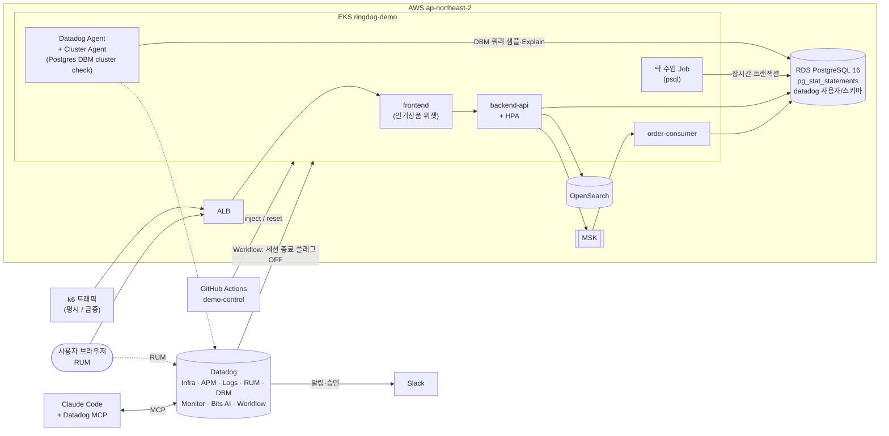

# 데모 통합 시나리오 ② "타임세일 트래픽 폭주 → DB 병목" 설계 (초안)

- 작성일: 2026-10-15
- 상태: **초안 — 2026-10-16 부서 회의 검토용**. 회의 결과 반영 후 구현 계획(`docs/design/plans/`) 작성
- 관련: 시나리오 ① [`2026-10-13-demo-bad-deploy-design.md`](./2026-10-13-demo-bad-deploy-design.md) (배포 결함)

## 1. 목적

부서 공용 Datadog 데모 환경(RingDog)에서 **Infra · APM · Log · RUM · DBM 5개 제품을 하나의 장애 흐름으로** 보여준다.
시나리오 ①이 "코드 결함(배포)"이라면, 시나리오 ②는 **"코드는 정상인데 데이터·트래픽·운영 작업이 겹쳐서 생기는 DB 장애"** 를 다룬다.
분석 단계마다 **Bits AI(SRE 조사 / Chat)** 와 **Datadog MCP Server** 를 사용하는 장면을 넣어, 사람이 화면을 오가는 분석과 AI 보조 분석을 함께 보여준다.

이 시나리오가 구축된 뒤 2단계로 **CI/CD Optimization, DSM, Jobs Monitoring** 시연을 같은 환경에 추가한다(7장).

### 보여줄 가치

| 메시지 | 근거 장면 |
|---|---|
| 사용자 체감에서 DB 원인까지 **한 화면씩 이어서** 내려간다 | RUM → APM 트레이스 → DB span → DBM 쿼리/Explain Plan |
| 원인이 두 개 겹쳐도 **분리해 낸다** | DBM의 "느린 쿼리(인덱스 누락)" vs "Blocking(락)" 을 각각 특정 |
| **잘못된 대응을 데이터로 막는다** | Pod 스케일 아웃이 DB 커넥션만 늘려 악화되는 장면 (Infra + DBM) |
| AI가 **근거와 함께** 원인을 요약하고, IDE에서 수정까지 이어진다 | Bits AI SRE 조사, Bits Chat 질의, MCP + Claude Code 인덱스 마이그레이션 PR |

### 성공 기준
- `demo-control inject` 실행 후 **5분 이내** Composite 모니터 알림
- 시연자가 RUM → APM → DBM → Infra → Log 순서로 원인 2개(인덱스 누락, 락 경합)를 **10분 이내** 특정
- 즉시 대처(블로킹 세션 종료 + 위젯 OFF) 후 **3분 이내** checkout p95 정상화
- `demo-control reset` 1회로 다음 시연자가 같은 상태에서 시작 가능

## 2. 시나리오 줄거리

> 오늘 20시 타임세일. 마케팅팀이 이벤트용 **"실시간 인기상품" 위젯**을 상품 목록에 켰다.
> 같은 시각 운영팀이 세일 가격 반영을 위해 **재고·가격 일괄 수정 배치**를 실행했다.
> 세일 시작과 함께 트래픽이 평시의 5~10배로 늘었고, 고객센터에 "결제 버튼을 눌러도 계속 돌기만 한다"는 문의가 들어온다.

| 겹친 원인 | 실제 동작 | Datadog에서 보이는 것 |
|---|---|---|
| ① 인덱스 누락 집계 쿼리 | 위젯 API가 `order_items`를 `product_id`로 집계. 인덱스가 없어 대량 데이터 Seq Scan → 페이지마다 수백 ms~수 초 | DBM Top Query 1위, Explain Plan `Seq Scan`, RDS CPU 100% / CPU 크레딧 소진 |
| ② 락 경합 | 일괄 수정 배치가 `products` 행을 잡은 채로 트랜잭션을 오래 유지 → checkout의 재고 차감 `UPDATE`가 대기 | DBM Blocking 트리, Wait Event `Lock:tuple/transactionid`, checkout 트레이스의 긴 postgres span |
| (증폭) 트래픽 급증 + HPA | Pod가 늘수록 Prisma 커넥션 풀 총합이 늘어 DB 부하 가중 | Infra Pod 수 증가와 DBM 커넥션 수·대기 증가가 같은 시점 |

## 3. 시연 진행 (약 25분)

| 단계 | 시간 | 시연자 행동 | 사용 제품 | 화면 / 포인트 |
|---|---|---|---|---|
| 0. 평시 | 3분 | 서비스 맵, RUM 대시보드, 데모 대시보드 소개 | Infra, APM, RUM | 정상 LCP·checkout p95·RDS CPU 기준선 |
| 1. 장애 주입 | 1분 | GitHub Actions `demo-control` → `action=inject` | — | k6 급증 + 위젯 ON + 락 주입 Job이 한 번에 실행 |
| 2. 탐지 | 3분 | Slack 알림 확인 | Monitor (Composite) | **RUM 결제 지연 AND APM checkout p95 증가** 일 때만 알림 → 단순 지연과 실제 장애 구분 |
| 3. AI 1차 조사 | 2분 | 모니터에서 **Bits AI SRE** 조사 결과 확인 | Bits AI SRE | 가설·근거(트레이스, DB 지표) 요약. 결론은 비결정적이므로 "1차 방향"으로만 활용 |
| 4. 사용자 영향 | 3분 | RUM에서 결제 버튼 frustration 세션 → Session Replay | RUM | 무한 로딩 화면, Rage Click. RUM → 연결된 APM 트레이스로 이동 |
| 5. 서비스 지연 | 3분 | checkout 트레이스 Flame Graph | APM, Log | postgres span 8초+. 같은 trace_id의 로그 `P2024 connection pool timeout` |
| 6. DB 원인 분리 | 5분 | DBM Query Metrics → Explain Plan / Blocking 트리 / Wait Event | DBM | **원인 ① 인기상품 쿼리 Seq Scan**, **원인 ② 배치 세션이 checkout을 블로킹** |
| 6-1. Bits Chat 질의 | (6에 포함) | DBM 화면에서 Bits Chat: "이 쿼리가 왜 느려졌고 어떻게 개선해?" / "지금 checkout을 막고 있는 세션은?" | Bits AI Chat | 자연어로 원인 확인. 화면 탐색과 같은 결론에 도달하는지 비교 |
| 7. 인프라 확인 | 2분 | RDS 호스트 / EKS Pod 화면 | Infra | RDS CPU·크레딧, HPA로 Pod 증가 → **커넥션 수도 같이 증가 = 스케일 아웃은 해법이 아님** |
| 8. 즉시 대처 | 2분 | Slack 승인 → Workflow 실행 | Workflow Automation | ① 블로킹 세션 `pg_terminate_backend` ② 위젯 플래그 OFF ③ 3분 후 p95 확인 보고 |
| 9. 근본 수정 | 3분 | Claude Code + Datadog MCP | MCP Server | "DBM에서 가장 느린 쿼리와 Explain Plan 가져와서 인덱스 마이그레이션 만들어줘" → Prisma 마이그레이션 + PR(머지 안 함) |
| 10. 정리 | 1분 | (선택) MCP로 장애 타임라인 요약 → 포스트모템 초안 | MCP / Bits AI | 탐지~회복 시각, 원인 2개, 재발 방지(인덱스, 배치 시간대 분리) |
| 리셋 | — | `demo-control` → `action=reset` | — | 인덱스 원복(삭제), 플래그 OFF, 락 Job 정리, k6 평시 |

### 대처 방법 정리 (대본 부록으로 사용)

| 구분 | 조치 | 비고 |
|---|---|---|
| 즉시 (완화) | 블로킹 세션 종료, 위젯 OFF | Workflow로 승인 1회. 트래픽(k6 급증)은 실제 상황처럼 유지한 채 회복을 보여줌 |
| 단기 | `order_items(product_id)` 인덱스 생성, 위젯 결과 캐시(예: 60초) | MCP로 PR 생성 |
| 운영 | 일괄 수정 배치를 세일 시간대 밖으로, 작은 단위 커밋 | 포스트모템 항목 |
| 하지 말아야 할 것 | Pod 스케일 아웃만 하는 것 | 7단계 장면으로 근거 제시 |

## 4. 환경 구조

### 4.1 구조도

### 4.2 추가·변경 항목

| 구분 | 내용 | 비고 |
|---|---|---|
| RDS 파라미터 그룹 | `shared_preload_libraries=pg_stat_statements`, `track_activity_query_size=4096`, (선택) `track_io_timing=on` | Terraform `modules/rds`에 파라미터 그룹 추가. 적용 시 재시작 필요 |
| RDS 사양 | `db.t3.micro`(1GB) → **`db.t3.small` 검토** | 대량 데이터 + DBM 수집 안정성. 비용 소폭 증가 (회의 결정) |
| DBM 준비 SQL | `datadog` 사용자, `datadog` 스키마, `pg_monitor` 권한, `pg_stat_statements` 확장, `datadog.explain_statement` 함수 | CD의 migrate 단계 뒤에 실행. 비밀번호는 Secrets Manager |
| Datadog Agent | Cluster Agent cluster check로 Postgres 체크 `dbm: true`, RDS 엔드포인트 직접 연결 | `deploy/helm/datadog-agent/values.yaml` (`clusterChecks` 활성화) |
| AWS 연동 | Datadog AWS Integration (CloudWatch: RDS·ALB·MSK, Resource Collection) | IAM Role은 비용이 없으므로 상시 유지 `infra/terraform/team/`에 배치 |
| 앱 (backend-api) | `GET /api/products/trending` (인덱스 없는 집계), checkout 재고 차감 `UPDATE products` 트랜잭션 | main에 반영. 위젯 플래그 OFF가 기본 |
| 앱 (frontend) | 상품 목록 상단 "실시간 인기상품" 위젯 (플래그 ON일 때만 호출) | RUM에 위젯 로딩 시간 표시 |
| 플래그 | ConfigMap 환경변수 `FEATURE_TRENDING_WIDGET` (기본) / Datadog Feature Flags (선택) | 회의 결정 |
| 데이터 | 대량 주문 시드 Job: 주문 약 50만 건, `order_items` 약 150만 건 | 환경 재생성마다 1회 실행 (약 10분 예상, 리허설로 확인) |
| k8s | backend-api HPA(CPU 기준, 1→4), k6 프로필 2종(평시 3~4 RPS / 급증 x5~10) | 시나리오 ①의 트래픽 생성기 재사용 |
| 데모 제어 | `.github/workflows/demo-control.yml` (workflow_dispatch: `spike` / `inject` / `reset`) | 인덱스 삭제·생성, 플래그 토글, 락 Job 실행/삭제 |
| Datadog 설정 | `datadog/` 에 JSON 보관: Composite 모니터, DBM 모니터(블로킹·장시간 쿼리), Workflow(세션 종료), 데모 대시보드 | 시나리오 ①과 같은 규칙(커밋 전 ID 마스킹) |

## 5. AI / MCP 사용 장면

| 단계 | 도구 | 프롬프트 예시 | 기대 결과 |
|---|---|---|---|
| 3 | Bits AI SRE (모니터 자동 조사) | (자동) | checkout 지연과 DB 대기 증가의 상관관계, 관련 트레이스·쿼리 근거 |
| 6-1 | Bits AI Chat (Datadog UI) | "이 쿼리가 왜 느려졌고 어떻게 개선하면 돼?" | Seq Scan, 인덱스 생성 제안 |
| 6-1 | Bits AI Chat | "지금 checkout 요청을 막고 있는 DB 세션이 뭐야?" | 배치 세션 PID·쿼리, 대기 시간 |
| 9 | Claude Code + MCP (`core,apm,dbm` toolset) | "Datadog DBM에서 ringdog DB의 가장 느린 쿼리와 Explain Plan을 가져와서, 개선할 Prisma 인덱스 마이그레이션을 만들어줘" | `@@index([productId])` 마이그레이션 + PR |
| 10 | Claude Code + MCP | "방금 장애의 탐지~회복 타임라인과 원인을 포스트모템 초안으로 정리해줘" | 모니터·이벤트 시각 기반 초안 |

- MCP 쓰기 도구(모니터·노트북 생성)는 org의 MCP Write Access 설정이 필요하다. 데모 org에서는 활성화를 전제로 한다.
- Bits AI 결론은 매번 다를 수 있으므로 대본에는 "예시 결론"만 적고, 리허설로 품질을 확인한다.

## 6. 안전장치 / 리스크

- **기준선 부족**: 환경을 상시 유지하지 않으므로 Watchdog·이상 탐지는 보조로만 사용. 탐지의 주 경로는 Composite 모니터
- **RDS t3 CPU 크레딧**: 크레딧이 남아 있으면 장애가 약하게 재현될 수 있음 → 리허설로 데이터량·급증 배율 조정. 반대로 크레딧이 바닥나면 리셋 후에도 느릴 수 있으므로 시연 간격 확보
- **락 주입 Job**: 최대 실행 시간 제한(예: 10분) 후 자동 종료 → 시연자가 잊어도 환경이 계속 막히지 않음
- **인덱스 삭제/생성**: `reset`이 항상 "인덱스 없음 + 플래그 OFF" 상태로 되돌림. 근본 수정 PR은 머지하지 않음(시나리오 ①과 같은 방식)
- **시나리오 ①과 공존**: 같은 환경·같은 Slack 채널 사용. 동시에 한 시나리오만 시연

## 7. 2단계 시연 (간략)

시나리오 ②가 구축된 뒤 같은 환경에 추가한다. 각 항목은 별도 설계 문서로 진행한다.

### 7.1 CI/CD Optimization (CI Visibility · Test Optimization)
- **환경**: 기존 GitHub Actions `ci.yml`/`cd.yml` + Datadog GitHub 연동. 진행 중이던 CI Visibility 작업(backend-api Vitest, Test Optimization 계측, `datadog-ci deployment mark`)을 이어서 완료
- **시나리오**: 일부러 만든 flaky 테스트가 간헐적으로 실패 → Datadog이 flaky로 분류, 실패 원인 확인 → 파이프라인 단계별 소요 시간에서 병목(Docker 빌드) 확인 → 캐시 적용 전후 비교. Test Impact Analysis로 변경 없는 테스트 건너뛰기, Quality Gates로 PR 차단, DORA 지표(배포 빈도·변경 실패율)
- **대처**: flaky 테스트 격리/수정, 빌드 캐시 적용, Quality Gate 규칙 조정

### 7.2 DSM (Data Streams Monitoring)
- **환경**: 이미 배선됨 (`backend-api` Producer → MSK `ringdog.orders` → `order-consumer`, `DD_DATA_STREAMS_ENABLED=true`)
- **시나리오**: `order-consumer` 처리 지연 주입(sleep) 또는 replica 0 → consumer lag 증가 → 주문이 `PENDING`에 머묾 → DSM 경로 지연·lag, 연결된 APM 서비스 확인 → RUM에서 "주문 내역이 결제 대기로 보임"
- **대처**: consumer 스케일 아웃 / 지연 원인 제거 → lag 해소 확인
- **확인 필요**: Kafka 메시지 조회(Kafka Console)는 Agent 7.84 이상 + 설정 필요

### 7.3 Jobs Monitoring (Data Observability)
- **환경 (신규)**: EKS에 Airflow(Helm) + Spark on Kubernetes(spark-operator). DAG `daily_sales_etl`: RDS 주문 데이터 → Spark 집계(일별 상품 매출) → RDS 리포팅 테이블. 웨어하우스는 사용하지 않음
- **시나리오**: 시나리오 ②의 대량 데이터로 Spark 잡이 느려지거나 OOM 실패 → Jobs Monitoring에서 이전 실행 대비 소요 시간·자원 사용·실패 단계 비교, Airflow DAG 지연 → 원인(데이터 skew / executor 메모리) 확인
- **대처**: executor 메모리·파티션 수 조정 후 재실행, 실행 시간 회귀 모니터
- **확인 필요**: Spark 잡용 노드 용량(t3.medium 2대로 부족 → 전용 노드 그룹/Spot 검토), Airflow·Spark 계측 방식(구현 계획에서 문서 기준으로 확정)

## 8. 회의 결정 필요 항목

| # | 항목 | 선택지 | 추천 |
|---|---|---|---|
| 1 | RDS 사양 | t3.micro 유지 / **t3.small** | t3.small (데이터량·DBM 안정성) |
| 2 | 위젯 플래그 | **ConfigMap 환경변수** / Datadog Feature Flags | ConfigMap으로 시작, Feature Flags는 이후 확장 |
| 3 | Jobs Monitoring 실행 위치 | 같은 EKS 전용 노드 그룹(Spot) / EMR on EKS | 같은 EKS + Spot 노드 그룹 (비용·구성 단순) |
| 4 | 담당·일정 | 시나리오 ② / 7.1 / 7.2 / 7.3 담당자 | 7.2(DSM)는 기존 배선이 있어 가장 빠름 |
| 5 | Slack·Workflow | 시나리오 ① 구성 재사용 여부 | 재사용 |

## 9. 범위 외
- Quality Monitoring (웨어하우스 필요 — 이번 범위에서 제외)
- ASM, LLM Observability 시나리오 (기존 배선만 유지)
- Android 앱 시나리오 연계 (웹 RUM만 사용)
